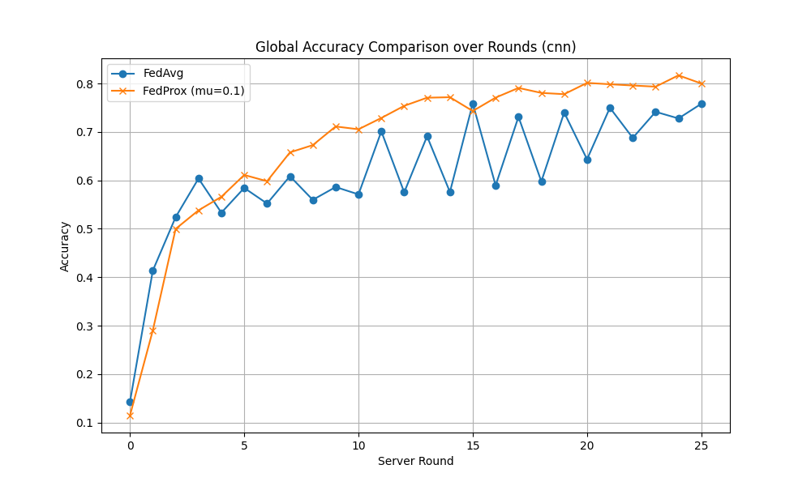
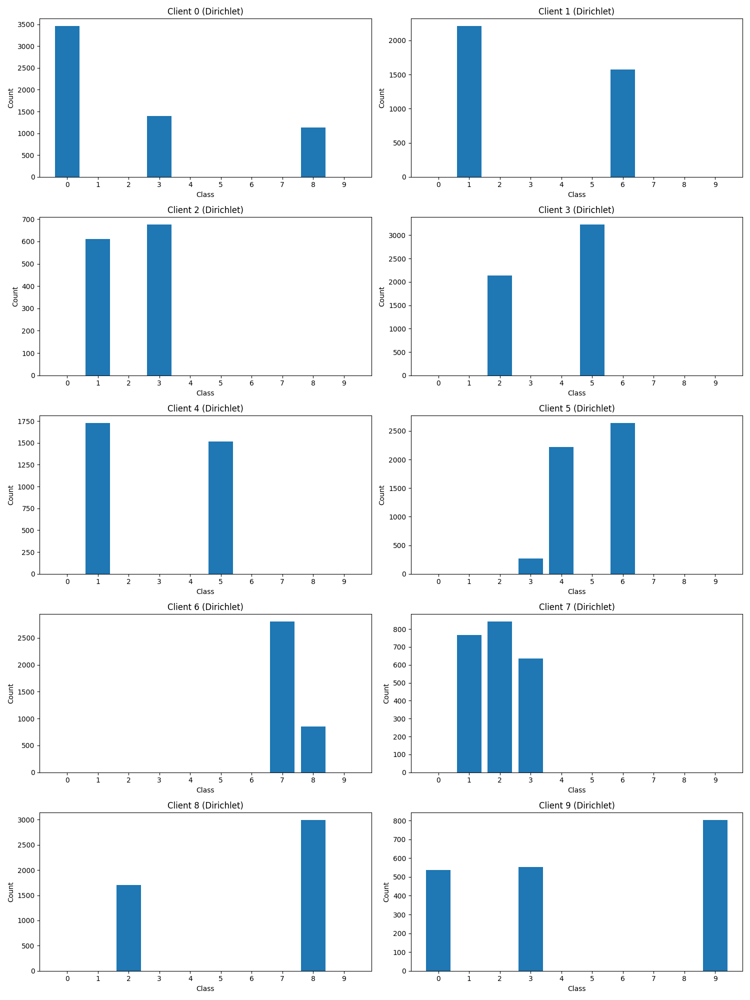
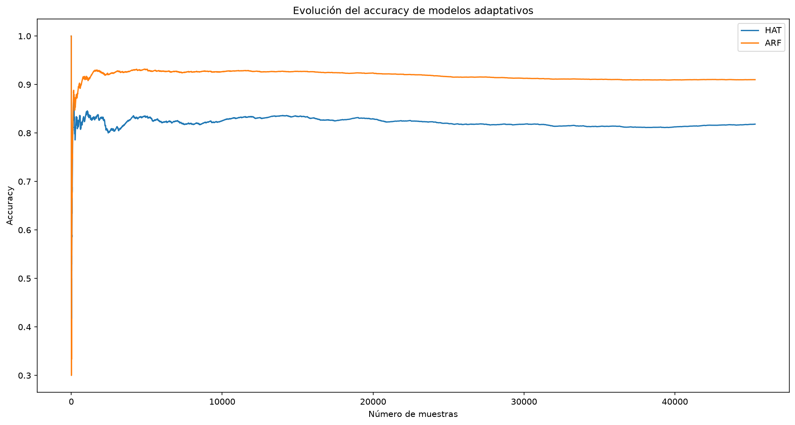

# Federated and Streaming Learning

Machine learning when the data cannot sit still: federated training over Non-IID clients with Flower and PyTorch, and online learning under concept drift with River.




Global test accuracy per round of a CNN trained over 10 Non-IID clients that never share their data: FedProx against FedAvg.

## Overview

Two self-contained projects that drop the classic assumptions of centralized, i.i.d., batch machine learning:

- **`federated/`** trains image classifiers on Fashion-MNIST distributed across 10 simulated clients that never share their data. It benchmarks **FedAvg** against **FedProx** on four architectures (MLP, CNN, ResNet-18, MobileNetV3-Small) under both IID and heavily Non-IID partitions.
- **`streaming/`** learns from the Electricity (Elec2) market stream one sample at a time: batch vs incremental Naive Bayes, **ADWIN** drift detection with model resets, and adaptive models (Hoeffding Adaptive Tree, Adaptive Random Forest).

## Federated learning: FedAvg vs FedProx

Each experiment runs both strategies back to back under identical conditions and evaluates the global model on the centralized test set after every round. Best global accuracy per run:

| Model | Rounds | Partitioning | FedAvg | FedProx (mu=0.1) |
|---|---|---|---|---|
| MLP | 50 | Non-IID | 0.7997 | **0.8113** |
| CNN | 25 | Non-IID | 0.7587 | **0.8168** |
| MobileNetV3-Small (pretrained) | 10 | IID | **0.8898** | 0.8759 |
| ResNet-18 (pretrained) | 5 | IID | **0.8899** | 0.8714 |

The pattern is the interesting part: FedProx's proximal term, which penalizes local updates for drifting away from the global model, clearly pays off under heterogeneity (+6 points on the Non-IID CNN), but buys nothing under IID partitions, where the pretrained backbones converge in a handful of rounds and plain FedAvg edges it out.

### Simulating heterogeneity

MLP and CNN clients get a deliberately hostile Non-IID setup: a Dirichlet partition (alpha=0.5) over labels, after which each client keeps only its 2 or 3 majority classes. Every client therefore sees a different, tiny slice of the label space:



### Engineering notes

- **BatchNorm does not survive federation.** BatchNorm layers carry running statistics that are meaningless when every client's data distribution is different, and they degrade badly under small local batches. `replace_bn_with_gn` recursively swaps every `BatchNorm2d` in the pretrained backbones for `GroupNorm`, adjusting the group count to divide each layer's channels.
- **Adapting ImageNet backbones to 28x28 grayscale.** ResNet-18's 7x7 stride-2 stem plus max-pool would crush a 28x28 input; both are replaced (3x3 stride-1 conv, `nn.Identity` for the pool). MobileNetV3 gets a 1-channel stride-1 first conv. Output heads are remapped to 10 classes.
- **FedProx in one term.** The client keeps a frozen copy of the incoming global weights and adds `(mu/2) * ||w - w_global||^2` to the loss; mu comes from the server through the run config, so FedAvg is just mu=0.
- **Reproducible experiment harness.** `run_all_experiments.py` rewrites the run config per model, launches `flwr run` as a subprocess, tees the output to per-model logs, and each run saves its exact TOML config, final model weights, best-round metrics and comparison plots.

## Streaming learning under concept drift

The Electricity dataset (Elec2, ~45k samples) labels whether the New South Wales electricity price rises or falls; its distribution shifts over time, which makes it a classic concept-drift benchmark. `streaming/streaming.py` walks through three stages:

1. **Batch vs incremental.** The same Gaussian Naive Bayes model trained once on a random 80% split (scikit-learn) against its incremental twin trained sample by sample with progressive validation (River). The incremental version wins: the stream has temporal dependence that a shuffled batch split ignores.
2. **Drift detection with ADWIN.** An ADWIN detector (delta=0.004) watches the price signal and resets the model whenever a distribution change is confirmed, compared against the same model left untouched.
3. **Adaptive models.** Hoeffding Adaptive Tree and Adaptive Random Forest pipelines (standardization + RBF feature expansion) that handle drift natively, with prequential accuracy tracked over the full stream.

Measured over the full stream with progressive validation (macro F1): resetting the Gaussian NB on ADWIN drift signals lifts it from 69.9% to 75.8%, and the natively adaptive models go further, 81.3% for the Hoeffding Adaptive Tree and 90.8% for the Adaptive Random Forest.



## Getting started

The two projects have independent environments.

### Federated (Flower + PyTorch)

Dependencies are locked in `uv.lock`; `uv sync` reproduces the exact environment.

```bash
cd federated
uv sync

# Single experiment (uses [tool.flwr.app.config] from pyproject.toml)
uv run flwr run .

# Override the run config, e.g. a quick smoke run
uv run flwr run . --run-config "model-type='mlp' num-server-rounds=2"

# Full benchmark: all 4 models, both strategies, logs + plots + saved models
uv run run_all_experiments.py
```

Fashion-MNIST is downloaded automatically through `flwr-datasets` on first run. Each run writes `metrics_plots/`, `client_distributions/`, `models/` and `best_metrics_log.txt` (all git-ignored).

### Streaming (River)

The script declares its own dependencies inline (PEP 723), so uv builds its environment automatically:

```bash
cd streaming
uv run streaming.py
```

Elec2 is downloaded automatically by River on first run. The script prints per-stage classification reports and saves the adaptive-models accuracy curve as a PNG.

## Project structure

```
.
├── federated/
│   ├── pyproject.toml            # Flower app config: strategies, rounds, partitioning
│   ├── uv.lock                   # Locked dependencies (uv sync)
│   ├── run_all_experiments.py    # Automated benchmark across all models
│   ├── calculate_stats.py        # Fashion-MNIST normalization statistics
│   ├── eda_fashion_mnist.ipynb   # Exploratory analysis of the dataset
│   └── project/
│       ├── client_app.py         # Local training and evaluation (FedProx-aware)
│       ├── server_app.py         # Runs FedAvg + FedProx, tracks metrics, plots
│       └── task.py               # Models, GroupNorm surgery, partitioning, train/test
├── streaming/
│   └── streaming.py              # Batch vs incremental, ADWIN, adaptive models (PEP 723)
└── docs/figures/                 # Result plots referenced in this README
```

## Credits

Team project built together with [Pablo Fernández (@appuchias)](https://github.com/appuchias) and [Miguel Planas (@miguelplanas)](https://github.com/miguelplanas). The Flower app started from Flower's public PyTorch quickstart scaffolding.

## References

- H. B. McMahan et al. (2017). *Communication-Efficient Learning of Deep Networks from Decentralized Data* (FedAvg). AISTATS.
- T. Li et al. (2020). *Federated Optimization in Heterogeneous Networks* (FedProx). MLSys.
- D. J. Beutel et al. (2020). [*Flower: A Friendly Federated Learning Framework*](https://flower.ai/). arXiv:2007.14390.
- A. Bifet, R. Gavaldà (2007). *Learning from Time-Changing Data with Adaptive Windowing* (ADWIN). SDM.
- J. Montiel et al. (2021). [*River: machine learning for streaming data in Python*](https://riverml.xyz/). JMLR.
- H. Xiao et al. (2017). *Fashion-MNIST: a Novel Image Dataset for Benchmarking Machine Learning Algorithms*. arXiv:1708.07747.
- M. Harries (1999). *SPLICE-2 Comparative Evaluation: Electricity Pricing* (Elec2).

## License

[MIT](LICENSE)
